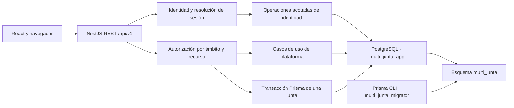
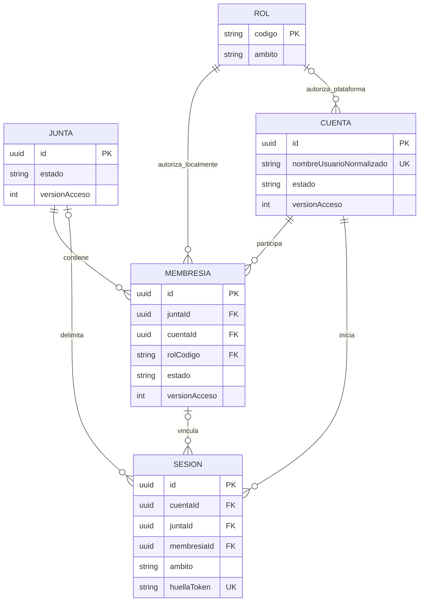
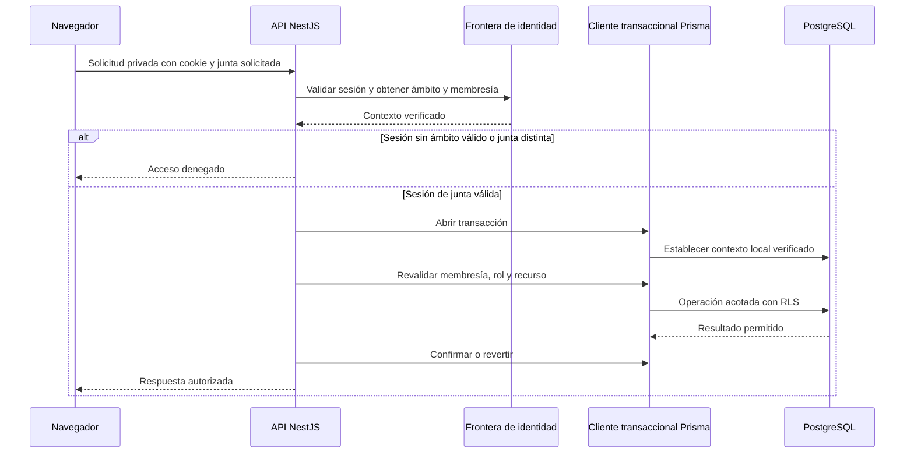

# Diseño de identidad y aislamiento multi-tenant

**Estado** Arquitectura general aprobada. Este documento registra el modelo de persistencia y el aislamiento incorporados en 1B.2. Las rutas, la autenticación y la autorización funcional se diseñan para entregas posteriores. Los puntos abiertos de `D-01` a `D-05` se resuelven en el corte que los requiera. [Requisitos y decisiones aprobadas](requirements.md)

La base de 1A y 1B.1 ofrece `GET /api/v1/health`, PostgreSQL 18 y credenciales separadas. [Compose](../../../compose.yaml), el [aprovisionamiento de roles](../../../ops/postgres/provision.sql) y la [prueba de privilegios](../../../apps/api/test/postgres.integration.mjs) son el punto de partida. El corte autorizado de 1B.2 comprende `Junta`, `Cuenta`, `Membresia`, `Rol` y `Sesion` en [Prisma](../../../apps/api/prisma/schema.prisma), junto con el aislamiento de persistencia. La emisión, autenticación y revocación de sesiones quedan en cortes posteriores. `D-02` sigue delimitando las altas y asignaciones funcionales.

## Arquitectura y límites de acceso

Identidad pertenece a Gestión de Plataforma dentro del monolito NestJS. Sus casos de uso gestionan credenciales, sesiones y membresías. Los módulos de negocio consultarán el contexto autenticado y aplicarán los permisos de sus propios recursos. En React, la navegación podrá usar el ámbito y las acciones devueltas por la API. Las decisiones de acceso corresponden a la API.

| Frontera                  | Responsabilidad propuesta                                                                                                                                                                                              |
| ------------------------- | ---------------------------------------------------------------------------------------------------------------------------------------------------------------------------------------------------------------------- |
| Identidad de plataforma   | Buscar una credencial por nombre normalizado, verificarla, gestionar el ciclo de sesión y resolver la proyección mínima de membresías de la cuenta autenticada. Conservar las huellas y los hashes en tablas privadas. |
| Operaciones de plataforma | Validar una sesión de plataforma y exponer casos de uso delimitados, como alta de junta y asignación de Administrador. Consultar únicamente los datos necesarios para cada acción.                                     |
| Operaciones de junta      | Exigir una sesión con una sola junta, revalidar la membresía y ejecutar las consultas en una transacción Prisma con RLS y comprobación de rol y titularidad.                                                           |
| Migraciones               | Usar `multi_junta_migrator` en Prisma CLI mediante `MIGRATION_DATABASE_URL`. Versionar restricciones, políticas y permisos por objeto.                                                                                 |

En Compose, la API conserva la configuración `PG*` exclusiva de `multi_junta_app`. En ejecución nativa utiliza `APP_DATABASE_URL`. La aplicación utiliza la cuenta de ejecución, sin propiedad sobre tablas ni permisos de DDL, `TRUNCATE` o cambio al rol migrador. El conjunto de permisos sobre nuevos objetos parte sin concesiones a la API. Cada migración concederá únicamente las operaciones requeridas y aplicará RLS antes de habilitar acceso a datos operativos. [Regla de operación del proyecto](../../../ops/README.md)

## Modelo de datos de Prisma en 1B.2

Los modelos están en `apps/api/prisma/schema.prisma`, con almacenamiento en el esquema PostgreSQL `multi_junta`. Los identificadores internos y referencias usan UUID. Los instantes de sesión se almacenan con zona horaria. En el modelo inicial, Junta, Cuenta y Membresía solo admiten `ACTIVA` e `INACTIVA`. Las reglas de transición de los flujos funcionales se precisarán en `D-02` y `D-04`.

| Modelo      | Campos principales                                                                                                                                                                   | Relaciones y reglas                                                                                                                                                                                                                                                                                                                            |
| ----------- | ------------------------------------------------------------------------------------------------------------------------------------------------------------------------------------ | ---------------------------------------------------------------------------------------------------------------------------------------------------------------------------------------------------------------------------------------------------------------------------------------------------------------------------------------------- |
| `Junta`     | `id`, `nombre`, `tipo`, `ruc`, `estado`, `versionAcceso`.                                                                                                                            | Una junta tiene muchas membresías y estado `ACTIVA` o `INACTIVA`. El RUC es opcional en el modelo inicial y globalmente único cuando se registra. Su obligatoriedad por tipo queda pendiente para el alta funcional en `D-01`. La versión de acceso permite invalidar sesiones al desactivar la junta y evitar que reaparezcan al reactivarla. |
| `Cuenta`    | `id`, `nombreUsuarioNormalizado`, `hashContrasena`, `estado`, `requiereCambioContrasena`, `versionAcceso` y referencia opcional a un rol de plataforma.                              | Unicidad global del nombre normalizado según el formato adoptado en `D-01`. Puede pertenecer a varias juntas. El estado global `ACTIVA` o `INACTIVA` y las credenciales pertenecen a Identidad.                                                                                                                                                |
| `Membresia` | `id`, `juntaId`, `cuentaId`, `rolCodigo`, `estado`, `versionAcceso`.                                                                                                                 | Una fila por par junta–cuenta y un rol local por fila, con estado `ACTIVA` o `INACTIVA`. La desactivación conserva su relación y el historial. El vínculo con el registro del socio se incorpora cuando exista el padrón y se confirme el flujo de alta.                                                                                       |
| `Rol`       | `codigo` estable, `ambito` y nombre mostrado.                                                                                                                                        | Catálogo de los cinco roles aprobados. Solo los códigos de ámbito `JUNTA` se asignan a membresías. El Super Administrador es el rol de ámbito `PLATAFORMA`. El catálogo se inicializa desde la migración, con escritura reservada al mantenimiento del esquema.                                                                                |
| `Sesion`    | `id`, `huellaToken` única, `cuentaId`, `ambito`, `juntaId` y `membresiaId` opcionales, versiones de acceso, emisión, expiración absoluta, expiración por inactividad y `revocadaEn`. | La sesión de junta referencia la membresía de esa cuenta y junta. Los ámbitos de plataforma y preliminar mantienen nulas las dos referencias locales. El ámbito preliminar permite solo concluir el acceso, según su propósito. La sesión mantiene su rol efectivo derivado de la autoridad vigente.                                           |

### Invariantes de persistencia

1. Prisma modela las claves únicas y las relaciones compuestas. `Membresia` tiene unicidad en `(juntaId, cuentaId)` y una clave candidata en `(juntaId, id, cuentaId)` para la referencia local de `Sesion`. El vínculo Junta–Sesión se deriva de esta FK, que impide vincular una sesión con otra junta o con la membresía de otra cuenta de la misma junta. Las tablas operativas futuras referenciarán el par `(juntaId, id)` de su recurso padre donde corresponda.
2. PostgreSQL verifica las asignaciones mediante la clave candidata `Rol(codigo, ambito)` y las FK con discriminadores de ámbito en `Cuenta` y `Membresia`. Un `CHECK` en `Sesion` exige ambas referencias locales cuando su ámbito es `JUNTA` y ambas nulas en los ámbitos `PLATAFORMA` y `PREVIA`. La validación de la sesión y del contexto autorizado en el servicio corresponde a un incremento posterior.
3. Un índice único parcial de PostgreSQL sobre `cuentaId`, filtrado por la asignación local activa de `ADMIN_JUNTA`, protege el máximo de una administración simultánea incluso con pedidos concurrentes. El índice permite varios administradores de una junta si el flujo finalmente lo admite. La transición de estados y las asignaciones pendientes se revisan en `D-02`.
4. `normalizeUsername` aplica el formato de `D-01` y podrá reutilizarse en alta, cambio e inicio de sesión. Elimina los espacios exteriores y valida que el texto contenga de 3 a 32 caracteres del conjunto ASCII `A-Z`, `a-z`, `0-9`, `.`, `-` y `_`. Solo entonces convierte las letras a minúsculas. PostgreSQL comprueba el formato canónico y aplica unicidad incluso para cuentas en estado `INACTIVA`. Si dos escrituras coinciden, se rechaza la duplicada sin fusionar cuentas ni alterar las membresías existentes.
5. Las referencias usan `RESTRICT` para impedir el borrado de filas con dependencias. Las bajas funcionales conservarán el historial e incrementarán la versión de acceso correspondiente en la misma transacción. Las restricciones SQL que Prisma no representa y las políticas RLS se mantienen en migraciones SQL versionadas. [Migraciones personalizadas de Prisma](https://www.prisma.io/docs/orm/v7/prisma-migrate/workflows/unsupported-database-features)

## Autenticación, sesión y revocación

Este flujo se mantiene como diseño para un incremento posterior. La persistencia de `Sesion` que se incorpora en 1B.2 permite comprobar ámbito e integridad referencial.

1. La API normaliza el nombre y busca la credencial por igualdad. Verifica Argon2id, la cuenta activa y los límites de intentos. Los fallos de credenciales o estado usan una respuesta genérica y los logs excluyen contraseñas, huellas y tokens. Los parámetros de Argon2id y los límites se ajustarán al entorno y se validarán en pruebas. [Almacenamiento de contraseñas en OWASP](https://cheatsheetseries.owasp.org/cheatsheets/Password_Storage_Cheat_Sheet.html)
2. Una contraseña temporal exige cambio antes de habilitar permisos. Se emite, cuando corresponde, una sesión preliminar acotada al propósito vigente. El servidor ofrece únicamente las membresías activas de la cuenta autenticada. Si se aplica selección automática al existir una sola membresía, el servidor valida igualmente junta, cuenta y membresía. Una sesión de plataforma requiere el rol global. Si una cuenta tiene ambos tipos de rol, la posibilidad de alternar se decide en `D-05` y cada sesión conserva un solo ámbito.
3. El cliente recibe un identificador opaco aleatorio en cookie `HttpOnly`, `Secure` bajo HTTPS y `SameSite`. La base conserva una huella del token con índice único. El acceso preliminar, el cambio inicial de contraseña y el cambio de contexto rotan el identificador al ampliar o cambiar el ámbito. Se invalida la sesión anterior al confirmar la transición. El navegador conserva la cookie y como máximo metadatos de presentación de la sesión.
4. Proponer despliegue de web y API en el mismo origen. Los cambios de estado, incluidos inicio, cambio de contexto y cierre, se protegen con validación de origen y un mecanismo CSRF para la sesión vigente o el flujo preliminar. El intercambio exacto y la política `SameSite` quedan en `D-04`. [Sesiones de OWASP](https://cheatsheetseries.owasp.org/cheatsheets/Session_Management_Cheat_Sheet.html) · [Prevención de CSRF de OWASP](https://cheatsheetseries.owasp.org/cheatsheets/Cross-Site_Request_Forgery_Prevention_Cheat_Sheet.html)
5. Por solicitud privada se comprueban huella, expiraciones, revocación, estado y versiones vigentes. El cierre revoca la sesión actual. Cambio de contraseña, modificación del rol global o desactivación global invalidan los accesos de la cuenta. Una baja o cambio de rol local invalida las sesiones de esa membresía y conserva el acceso válido a otras juntas. La desactivación de una junta invalida todas las sesiones de su ámbito. Las versiones impiden que la reactivación revalide un token anterior. La política para operaciones sensibles ya iniciadas se precisa en `D-05`.

## RBAC, titularidad y altas controladas

| Rol                                  | Ámbito y permisos de referencia                                                                                                                                                                                            |
| ------------------------------------ | -------------------------------------------------------------------------------------------------------------------------------------------------------------------------------------------------------------------------- |
| Super Administrador de la Plataforma | Plataforma. Alta de juntas y asignación de Administradores cuando estén autorizadas en la entrega. Acceso a la proyección de plataforma necesaria para esas operaciones.                                                   |
| Administrador de la Junta            | Su junta. Gestión local de membresías de Secretaría, Tesorería y Socio. Alta excepcional del primer Secretario mediante un procedimiento auditable. La baja local preserva los demás vínculos de la cuenta y el historial. |
| Secretario/a                         | Su junta. Acciones administrativas y documentales autorizadas por sus especificaciones.                                                                                                                                    |
| Tesorero/a                           | Su junta. Acciones financieras autorizadas por sus especificaciones.                                                                                                                                                       |
| Miembro / Socio                      | Su junta. Recursos propios según titularidad y acciones de su rol. La identidad del titular se deriva de la sesión y su membresía.                                                                                         |

El orden de autorización es ámbito → cuenta y sesión activas → junta y membresía vigentes → permiso sobre la acción → titularidad o acceso al recurso. La pertenencia a una junta es condición necesaria para sus datos operativos. Las consultas del socio restringen también listados, filtros y recursos privados del mismo ámbito. El identificador solicitado por el cliente selecciona el recurso y cada búsqueda se resuelve dentro del ámbito autorizado. La matriz acción–recurso, sus campos de salida y los errores se cierran en `D-05`. Para RF-33, la regla de misma junta aplica a destinatarios y mensajes cuando se implemente Comunicaciones.

Para el primer Super Administrador se propone una operación de inicialización controlada, fuera de las rutas públicas, con una transacción y una condición idempotente de instalación. Para el primer Secretario se propone una marca persistente de habilitación consumida una sola vez dentro de la misma transacción que registra la asignación y su auditoría. La baja posterior de Secretaría mantiene consumida esa condición. El vínculo con un integrante del padrón, la forma de proveer datos y el circuito ordinario de alta se aprueban en `D-02` y `D-03`. Los administradores locales actúan sobre las membresías de su junta. Cualquier vinculación con cuentas preexistentes se valida mediante el flujo de identidad autorizado.

## RLS y transacciones con Prisma

### Alcance de 1B.2

El contexto RLS indica qué filas puede consultar o modificar una transacción. No autentica por sí mismo al usuario. En 1B.2, `TenantUnitOfWork` valida el UUID y fija `app.junta_id` mediante `set_config` parametrizado y local a la transacción interactiva de Prisma. El repositorio de membresías recibe el cliente de esa misma transacción y proyecta solo sus metadatos. Las pruebas proporcionan contextos sintéticos controlados. La derivación del contexto a partir de una sesión autenticada y la verificación de su membresía se incorporarán en un incremento posterior.

`Membresia` y `Sesion` usan `ENABLE` y `FORCE ROW LEVEL SECURITY`, con `USING` y `WITH CHECK` para el rol operativo. Un contexto ausente o inválido no autoriza filas. En `Sesion`, la política solo admite filas del ámbito `JUNTA`. La migración deja los objetos de identidad sin permisos operativos. La suite concede permisos por objeto tras activar las políticas, exclusivamente en la base aislada de prueba, y los revoca al finalizar.

### Resolver la identidad antes de entrar en una junta

El flujo previo al contexto requiere consultar exactamente una credencial o validar el token de sesión. Las tablas de credenciales y sesiones quedan bajo el límite de Identidad, sin concesión de lectura general al cliente operativo. `Junta` es el registro de plataforma y sus campos de selección se exponen mediante una proyección autorizada. `Membresia` y las tablas operativas locales tendrán RLS forzada.

Las funciones `SECURITY DEFINER` son una propuesta técnica para un incremento posterior, sujeta al cierre de `D-05`. En 1B.2 quedan fuera de las migraciones y del aprovisionamiento. Si se aprueban, podrían verificar una sesión y obtener las membresías activas de su cuenta mediante una política de solo lectura para el propietario de la función. `D-05` debe confirmar el propietario, sus privilegios y su aprovisionamiento. Una opción es un rol interno `NOLOGIN` de privilegios mínimos, aprovisionado de forma controlada porque el migrador carece de `CREATEROLE`. Se conservarían los dos roles de conexión de 1B.1 y se concedería a la API solo ejecución sobre las operaciones explícitas, con `EXECUTE` revocado de `PUBLIC`, referencias calificadas y un `search_path` de confianza. [Funciones y seguridad en PostgreSQL](https://www.postgresql.org/docs/18/sql-createfunction.html)

La política de proyección se limita al propietario autorizado y a la cuenta validada, incluso con `FORCE ROW LEVEL SECURITY`. Si la función usa un parámetro de contexto, el diseño deberá restaurarlo al salir con la configuración local de esa función o aislar la consulta en una transacción independiente. Se probará el caso de error y la ausencia de contexto residual antes de habilitar el flujo.

### Operación de junta con sesión autenticada

La siguiente secuencia corresponde al incremento que integre la identidad autenticada con el contexto de junta.

1. A partir de la sesión validada, el servidor compara la junta solicitada con la vinculada y abre una transacción interactiva de Prisma.
2. La unidad de trabajo fija `app.junta_id` con `set_config` parametrizado y alcance local a esa transacción. Si la titularidad lo requiere, fija también la cuenta y membresía ya verificadas. La transacción revalida el contexto y la autorización antes de consultar o mutar el recurso.
3. Los repositorios reciben el cliente de la transacción. Si una operación pasa por dos módulos, ambos usan ese mismo cliente. Las transacciones se mantienen breves y el hashing de contraseñas o las llamadas de red se realizan fuera de ellas.
4. Las políticas de las tablas de junta aplican `ENABLE` y `FORCE ROW LEVEL SECURITY`. `USING` restringe las filas visibles o modificables y `WITH CHECK` restringe el estado nuevo. Un contexto ausente o vacío deniega operaciones sobre filas. La FK compuesta evita relaciones cruzadas incluso cuando existe autorización sobre la fila nueva.
5. Los predicados de titularidad de recursos privados se combinan con la condición de junta. Al añadir varias políticas se verifica cómo se combinan para evitar que una política permisiva amplíe las filas visibles. Las pruebas repiten solicitudes con conexiones reutilizadas, tanto después de confirmar como después de revertir. [RLS en PostgreSQL](https://www.postgresql.org/docs/18/ddl-rowsecurity.html) · [Parámetros locales a la transacción](https://www.postgresql.org/docs/18/functions-admin.html#FUNCTIONS-ADMIN-SET) · [Transacciones de Prisma](https://www.prisma.io/docs/orm/v7/prisma-client/queries/transactions)

## Endpoints REST previstos

Los contratos son candidatos a revisar con `D-02` a `D-05`. Las respuestas de identidad contienen únicamente datos de presentación y permisos autorizados.

| Método y ruta                                                                                                                        | Ámbito y contrato previsto                                                                                                                                          |
| ------------------------------------------------------------------------------------------------------------------------------------ | ------------------------------------------------------------------------------------------------------------------------------------------------------------------- |
| `POST /api/v1/auth/iniciar-sesion`                                                                                                   | Acepta usuario y contraseña. Verifica credenciales y devuelve una sesión preliminar o definitiva según estado y ámbito. La sesión se entrega mediante cookie.       |
| `GET /api/v1/auth/sesion`                                                                                                            | Devuelve estado de acceso, contexto vigente y datos mínimos de la cuenta. Una sesión preliminar obtiene solo la información permitida para concluir el acceso.      |
| `GET /api/v1/auth/contextos`                                                                                                         | Ofrece las juntas elegibles de la cuenta autenticada. La proyección incluye solo información necesaria para elegir ámbito.                                          |
| `POST /api/v1/auth/contexto`                                                                                                         | Solicita una junta elegible o el ámbito de plataforma autorizado. Al completarse, rota la sesión y emite el contexto validado.                                      |
| `POST /api/v1/auth/cambiar-contrasena`                                                                                               | Requiere autoridad para el cambio, incluida la sesión preliminar de contraseña temporal. Actualiza la credencial y aplica la revocación o reemisión prevista.       |
| `POST /api/v1/auth/cerrar-sesion`                                                                                                    | Revoca la sesión actual y limpia su cookie.                                                                                                                         |
| `POST /api/v1/plataforma/juntas` y `POST /api/v1/plataforma/juntas/:juntaId/administradores`                                         | Alta y asignación autorizadas para Super Administrador. Campos, confirmaciones y términos de aprovisionamiento en `D-01` a `D-03`.                                  |
| `GET /api/v1/juntas/:juntaId/membresias`, `POST /api/v1/juntas/:juntaId/membresias` y `PATCH /api/v1/juntas/:juntaId/membresias/:id` | Proyección y gestión local por el Administrador de Junta. Las escrituras validan roles asignables y la pertenencia a la junta, y conservan historial al desactivar. |
| `POST /api/v1/juntas/:juntaId/secretaria-inicial`                                                                                    | Procedimiento excepcional propuesto para el Administrador de esa junta. La operación y la auditoría se confirman atómicamente.                                      |
| `GET /api/v1/juntas/:juntaId/mi/membresia`                                                                                           | Proyección propia derivada de la sesión. Sirve como primer contrato para probar titularidad sin depender del padrón completo.                                       |

La primera cuenta de Super Administrador se crea mediante la inicialización controlada. El endpoint de salud de 1A conserva su contrato y su independencia de la conexión a la base. Proponemos `401` para sesión inválida, `403` para acciones fuera del permiso y una respuesta equivalente a recurso ausente al consultar identificadores ajenos. La semántica exacta y la prevención de enumeración en altas y consultas se aprueban en `D-03` y `D-05`.

## Estrategia de pruebas y seguridad

Las pruebas usan datos sintéticos con juntas A y B, dos socios A1 y A2 y un socio B1. Incluir también una cuenta con membresías en A y B, un Administrador local y un Super Administrador. Las verificaciones de RLS se ejecutan con PostgreSQL real y con el rol de ejecución utilizado por NestJS.

| Área                         | Pruebas previstas y evidencia                                                                                                                                                                                                                                                                                                                                                                                                                                      |
| ---------------------------- | ------------------------------------------------------------------------------------------------------------------------------------------------------------------------------------------------------------------------------------------------------------------------------------------------------------------------------------------------------------------------------------------------------------------------------------------------------------------ |
| Modelo e integridad          | Probar los límites de 3 y 32 caracteres, espacios exteriores e interiores, mayúsculas y rechazo de caracteres no ASCII. Los duplicados, incluso concurrentes, se rechazan sin fusionar cuentas. Verificar los dos estados iniciales, la unicidad global del RUC cuando esté presente y la ausencia de RUC en el modelo inicial. Conservar las pruebas de concurrencia al asignar Administrador, historial, roles locales, vínculos independientes y FK compuestas. |
| Aprovisionamiento            | Inicialización controlada del primer Super Administrador y alta excepcional del primer Secretario. Verificar actor autorizado, repetición segura, concurrencia, rechazo desde otra junta y persistencia de la marca tras una baja.                                                                                                                                                                                                                                 |
| Inicio y cookies             | Credenciales válidas e inválidas, errores sin enumeración, contraseña temporal, selección limitada a membresías activas, atributos de cookie, CSRF y evasión mediante cambio de identificador de junta.                                                                                                                                                                                                                                                            |
| Revocación                   | Expiración absoluta e inactiva, cierre, rotación al cambiar de junta, rechazo del token anterior, cambio de rol y desactivación a nivel de cuenta, membresía o junta. La baja local preserva otra membresía activa y la reactivación requiere sesión nueva.                                                                                                                                                                                                        |
| Ámbito y titularidad         | A y B acceden a sus datos. Solicitudes A → B y B → A fallan en lectura y escritura sin revelar existencia ni cambiar filas. A1 y A2 quedan limitados a recursos propios dentro de A. Verificar también búsquedas y proyecciones sin mezcla.                                                                                                                                                                                                                        |
| RLS y pool                   | En 1B.2, usar contextos sintéticos controlados. Probar SELECT, UPDATE y DELETE sin contexto, rechazo de INSERT y de cambios a otra junta, FK compuestas y denegación directa con `multi_junta_app`. Verificar A → sin contexto → B sobre el mismo backend del pool después de `COMMIT` y `ROLLBACK`, más operaciones concurrentes. Reutilizar la prueba de privilegios de 1B.1 y reservar la prueba con sesión autenticada para el incremento que la incorpore.    |
| Plataforma, logs y regresión | Super Administrador autorizado para sus acciones globales y denegado en operación de junta. Auditar asignaciones y revocaciones sin contraseñas, huellas ni tokens. Confirmar migraciones desde una base nueva, formato, lint, build y salud de la API.                                                                                                                                                                                                            |

## Decisiones que condicionan el diseño

- **`D-01`** El formato de nombre de usuario de 1B.2 se aplica en el modelo. La obligatoriedad del RUC por tipo de organización queda pendiente para el alta funcional. Su unicidad global aplica a todo RUC registrado.
- **`D-02`** Alcance de altas en cada entrega, estados de asignación y detalles del aprovisionamiento inicial. Incluye la coordinación con el padrón y la política sobre el último Administrador.
- **`D-03`** Mecanismo de entrega, reuso y recuperación de credenciales. Incluye la identificación autorizada de una cuenta existente y qué información puede revelarse durante el alta.
- **`D-04`** Duraciones, límites de intentos, concurrencia de sesiones, selector, rotación, origen web y protección CSRF concreta.
- **`D-05`** Permisos por operación y campo, reglas de titularidad, errores, auditoría y retención, y tratamiento de operaciones en curso tras una revocación. Incluye confirmar la frontera previa al ámbito de junta y decidir si se autoriza la propuesta `SECURITY DEFINER` en un incremento posterior.

La secuencia de entrega y los criterios de cierre de cada corte están en [tasks.md](tasks.md).
