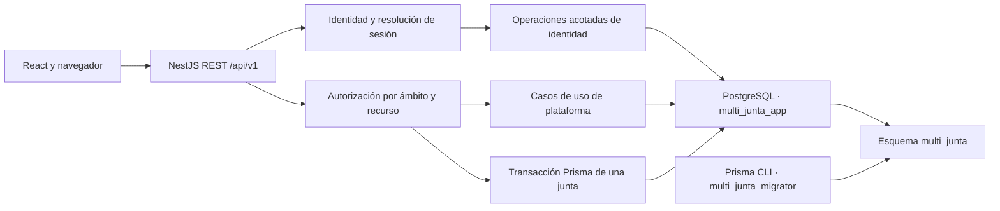
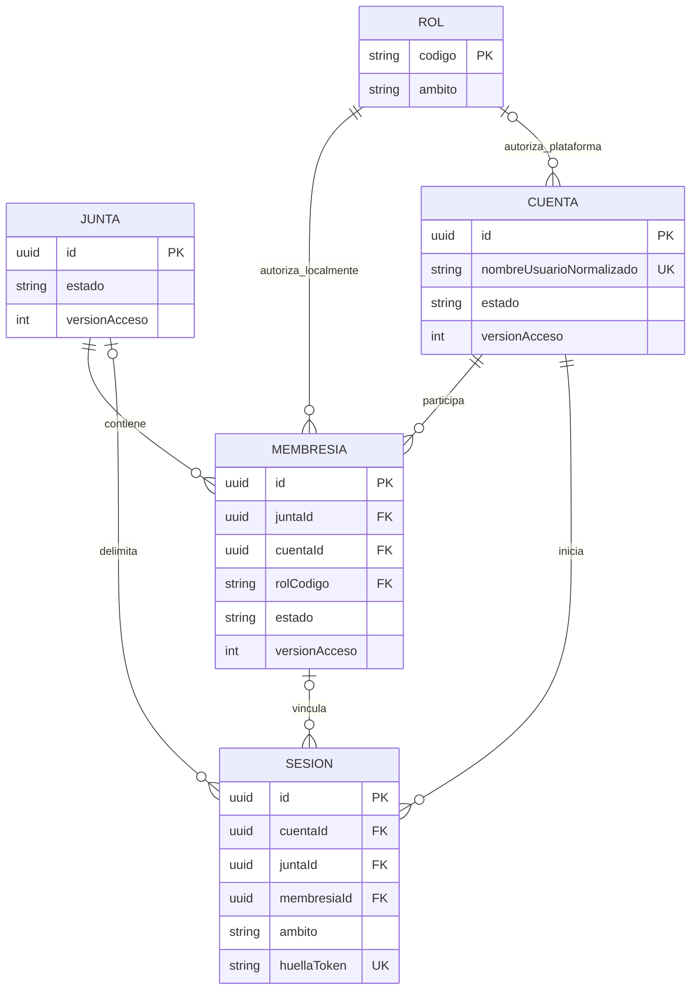
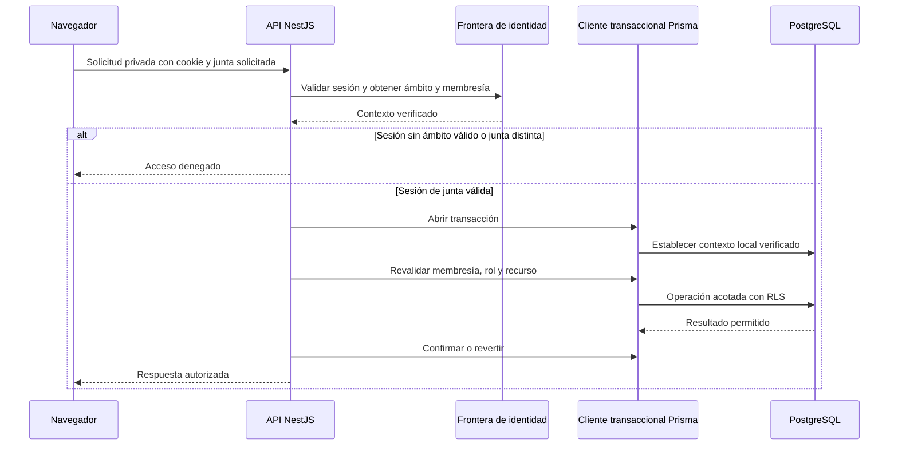

# Diseño de identidad y aislamiento multi-tenant

**Estado** Arquitectura general aprobada. El modelo de persistencia y RLS son la base de 1B.2. En 1B.3 se incorporan las rutas de identidad y la autorización inicial. Los casos de negocio y los puntos abiertos se resuelven en sus cortes correspondientes. [Requisitos y decisiones aprobadas](requirements.md)

## Decisiones técnicas de 1B.3

- **D-03** El primer Super Administrador se aprovisiona por CLI con credenciales suministradas al proceso y permisos del migrador. La inicialización toma un bloqueo transaccional y registra un único evento auditable. Una cuenta marcada con `requiereCambioContrasena` recibe una sesión preliminar restringida. El cambio exige la contraseña actual, actualiza la credencial e invalida las sesiones de la cuenta. Se inicia sesión nuevamente con la contraseña nueva. La entrega y vigencia de credenciales temporales, la recuperación y la vinculación por cédula quedan pendientes de los flujos de alta.
- **D-04** La sesión usa un token opaco aleatorio de 256 bits. PostgreSQL conserva SHA-256 del token. Los valores iniciales configurables son 30 minutos de inactividad y 12 horas absolutas. Cambiar de ámbito rota el token y conserva el vencimiento absoluto. Se admiten sesiones independientes. El ámbito inicial es `PLATAFORMA` para un Super Administrador y `PREVIA` para una cuenta local. La selección explícita consulta solo juntas activas con membresía propia activa. La API usa una cookie `HttpOnly`, `SameSite=Strict`, `Secure` bajo HTTPS y sin dominio. Toda mutación exige el `Origin` configurado y una cabecera CSRF. El inicio exige `X-CSRF-Token: inicio` y JSON. Para sesiones se envía un token CSRF derivado del token opaco mediante HMAC y separado de su huella de persistencia. La API carece de CORS para este flujo. Los intentos se limitan en PostgreSQL con ventanas por nombre de usuario normalizado y por IP de la conexión, sin confiar en cabeceras de proxy.
- **D-05 de 1B.3** Las rutinas de identidad de firmas concretas se ejecutan como `multi_junta_identity`, un rol `NOLOGIN` sin `BYPASSRLS`, sin propiedad de las tablas y con privilegios por columna. Las políticas dedicadas restringen el acceso de ese rol a las tablas con RLS. Se fija `search_path` y se revoca `EXECUTE` a `PUBLIC`. `multi_junta_app` obtiene ejecución de las rutinas aprobadas, sin acceso directo a credenciales ni sesiones. La validación consulta estado, ámbito, revocación, expiraciones y versiones en PostgreSQL. Los cambios de estado, rol y credenciales incrementan sus versiones en la misma escritura y se vuelven efectivos para las validaciones posteriores. La matriz de módulos y la semántica de operaciones sensibles ya iniciadas se precisan con cada caso de uso. Las auditorías de este corte conservan identificadores internos y tipos de evento.
- **Contrato local de identidad** `GET /api/v1/juntas/:juntaId/mi/membresia` devuelve metadatos de la propia membresía cuando la sesión está en esa junta. Las guardas separan sesión, ámbito y rol y deniegan por defecto cuando falta permiso explícito. El identificador de ruta sirve para contrastar el ámbito. La consulta transaccional recibe la junta resuelta por la sesión. La titularidad de los recursos de negocio permanece en sus módulos.

La base de 1A y 1B.1 ofrece `GET /api/v1/health`, PostgreSQL 18 y credenciales separadas. [Compose](../../../compose.yaml), el [aprovisionamiento de roles](../../../ops/postgres/provision.sql) y la [prueba de privilegios](../../../apps/api/test/postgres.integration.mjs) son el punto de partida. El corte 1B.2 comprende `Junta`, `Cuenta`, `Membresia`, `Rol` y `Sesion` en [Prisma](../../../apps/api/prisma/schema.prisma), junto con el aislamiento de persistencia. `D-02` sigue delimitando las altas y asignaciones funcionales.

## Arquitectura y límites de acceso

Identidad pertenece a Gestión de Plataforma dentro del monolito NestJS. Sus casos de uso gestionan credenciales, sesiones y membresías. Los módulos de negocio consultarán el contexto autenticado y aplicarán los permisos de sus propios recursos. En React, la navegación podrá usar el ámbito y las acciones devueltas por la API. Las decisiones de acceso corresponden a la API.

| Frontera                  | Responsabilidad propuesta                                                                                                                                                                                              |
| ------------------------- | ---------------------------------------------------------------------------------------------------------------------------------------------------------------------------------------------------------------------- |
| Identidad de plataforma   | Buscar una credencial por nombre normalizado, verificarla, gestionar el ciclo de sesión y resolver la proyección mínima de membresías de la cuenta autenticada. Conservar las huellas y los hashes en tablas privadas. |
| Operaciones de plataforma | Validar una sesión de plataforma y exponer casos de uso delimitados, como alta de junta y asignación de Administrador. Consultar únicamente los datos necesarios para cada acción.                                     |
| Operaciones de junta      | Exigir una sesión con una sola junta, revalidar la membresía y ejecutar las consultas en una transacción Prisma con RLS y comprobación de rol y titularidad.                                                           |
| Migraciones               | Usar `multi_junta_migrator` en Prisma CLI mediante `MIGRATION_DATABASE_URL`. Versionar restricciones, políticas y permisos por objeto.                                                                                 |

En Compose, la API conserva la configuración `PG*` exclusiva de `multi_junta_app`. En ejecución nativa utiliza `APP_DATABASE_URL`. La aplicación utiliza la cuenta de ejecución, sin propiedad sobre tablas ni permisos de DDL, `TRUNCATE` o cambio al rol migrador. El conjunto de permisos sobre nuevos objetos parte sin concesiones a la API. Cada migración concederá únicamente las operaciones requeridas y aplicará RLS antes de habilitar acceso a datos operativos. [Regla de operación del proyecto](../../../ops/README.md)

## Modelo de datos de Prisma en 1B.2

Los modelos están en `apps/api/prisma/schema.prisma`, con almacenamiento en el esquema PostgreSQL `multi_junta`. Los identificadores internos y referencias usan UUID. Los instantes de sesión se almacenan con zona horaria. En el modelo inicial, Junta, Cuenta y Membresía solo admiten `ACTIVA` e `INACTIVA`. Las reglas de transición de los flujos funcionales se precisarán en `D-02` y `D-04`.

| Modelo      | Campos principales                                                                                                                                                                   | Relaciones y reglas                                                                                                                                                                                                                                                                                                                            |
| ----------- | ------------------------------------------------------------------------------------------------------------------------------------------------------------------------------------ | ---------------------------------------------------------------------------------------------------------------------------------------------------------------------------------------------------------------------------------------------------------------------------------------------------------------------------------------------- |
| `Junta`     | `id`, `nombre`, `tipo`, `ruc`, `estado`, `versionAcceso`.                                                                                                                            | Una junta tiene muchas membresías y estado `ACTIVA` o `INACTIVA`. El RUC es opcional en el modelo inicial y globalmente único cuando se registra. Su obligatoriedad por tipo queda pendiente para el alta funcional en `D-01`. La versión de acceso permite invalidar sesiones al desactivar la junta y evitar que reaparezcan al reactivarla. |
| `Cuenta`    | `id`, `nombreUsuarioNormalizado`, `hashContrasena`, `estado`, `requiereCambioContrasena`, `versionAcceso` y referencia opcional a un rol de plataforma.                              | Unicidad global del nombre normalizado según el formato adoptado en `D-01`. Puede pertenecer a varias juntas. El estado global `ACTIVA` o `INACTIVA` y las credenciales pertenecen a Identidad.                                                                                                                                                |
| `Membresia` | `id`, `juntaId`, `cuentaId`, `rolCodigo`, `estado`, `versionAcceso`.                                                                                                                 | Una fila por par junta–cuenta y un rol local por fila, con estado `ACTIVA` o `INACTIVA`. La desactivación conserva su relación y el historial. El vínculo con el registro del socio se incorpora cuando exista el padrón y se confirme el flujo de alta.                                                                                       |
| `Rol`       | `codigo` estable, `ambito` y nombre mostrado.                                                                                                                                        | Catálogo de los cinco roles aprobados. Solo los códigos de ámbito `JUNTA` se asignan a membresías. El Super Administrador es el rol de ámbito `PLATAFORMA`. El catálogo se inicializa desde la migración, con escritura reservada al mantenimiento del esquema.                                                                                |
| `Sesion`    | `id`, `huellaToken` única, `cuentaId`, `ambito`, `juntaId` y `membresiaId` opcionales, versiones de acceso, emisión, expiración absoluta, expiración por inactividad y `revocadaEn`. | La sesión de junta referencia la membresía de esa cuenta y junta. Los ámbitos de plataforma y preliminar mantienen nulas las dos referencias locales. El ámbito preliminar permite solo concluir el acceso, según su propósito. La sesión mantiene su rol efectivo derivado de la autoridad vigente.                                           |

### Invariantes de persistencia

1. Prisma modela las claves únicas y las relaciones compuestas. `Membresia` tiene unicidad en `(juntaId, cuentaId)` y una clave candidata en `(juntaId, id, cuentaId)` para la referencia local de `Sesion`. El vínculo Junta–Sesión se deriva de esta FK, que impide vincular una sesión con otra junta o con la membresía de otra cuenta de la misma junta. Las tablas operativas futuras referenciarán el par `(juntaId, id)` de su recurso padre donde corresponda.
2. PostgreSQL verifica las asignaciones mediante la clave candidata `Rol(codigo, ambito)` y las FK con discriminadores de ámbito en `Cuenta` y `Membresia`. Un `CHECK` en `Sesion` exige ambas referencias locales cuando su ámbito es `JUNTA` y ambas nulas en los ámbitos `PLATAFORMA` y `PREVIA`. 1B.3 valida la sesión vigente antes de resolver el contexto autorizado.
3. Un índice único parcial de PostgreSQL sobre `cuentaId`, filtrado por la asignación local activa de `ADMIN_JUNTA`, protege el máximo de una administración simultánea incluso con pedidos concurrentes. El índice permite varios administradores de una junta si el flujo finalmente lo admite. La transición de estados y las asignaciones pendientes se revisan en `D-02`.
4. `normalizeUsername` aplica el formato de `D-01` y podrá reutilizarse en alta, cambio e inicio de sesión. Elimina los espacios exteriores y valida que el texto contenga de 3 a 32 caracteres del conjunto ASCII `A-Z`, `a-z`, `0-9`, `.`, `-` y `_`. Solo entonces convierte las letras a minúsculas. PostgreSQL comprueba el formato canónico y aplica unicidad incluso para cuentas en estado `INACTIVA`. Si dos escrituras coinciden, se rechaza la duplicada sin fusionar cuentas ni alterar las membresías existentes.
5. Las referencias usan `RESTRICT` para impedir el borrado de filas con dependencias. Las bajas funcionales conservarán el historial e incrementarán la versión de acceso correspondiente en la misma transacción. Las restricciones SQL que Prisma no representa y las políticas RLS se mantienen en migraciones SQL versionadas. [Migraciones personalizadas de Prisma](https://www.prisma.io/docs/orm/v7/prisma-migrate/workflows/unsupported-database-features)

## Autenticación, sesión y revocación

1. La API normaliza el usuario y consulta la credencial por igualdad después de aplicar el límite de intentos. Argon2id usa 19 MiB, dos iteraciones y paralelismo uno. Los fallos de credenciales y estados usan la misma respuesta. La verificación contra un hash auxiliar cubre cuentas inexistentes. [Almacenamiento de contraseñas en OWASP](https://cheatsheetseries.owasp.org/cheatsheets/Password_Storage_Cheat_Sheet.html)
2. La cuenta que requiere cambio usa un ámbito `PREVIA` restringido. El cambio exige la contraseña actual y una contraseña nueva de al menos 12 caracteres y hasta 256 bytes. Tras invalidar sus sesiones, la cuenta vuelve a autenticarse. Una cuenta con rol global y roles locales puede seleccionar uno autorizado cada vez. La autorización del rol global termina al seleccionar contexto local.
3. El navegador recibe el token opaco por cookie. Obtiene su valor CSRF en la respuesta de inicio o al consultar la sesión. Las rutas privadas devuelven metadatos de presentación. Los cambios de estado se realizan en el origen configurado para el navegador. [Sesiones de OWASP](https://cheatsheetseries.owasp.org/cheatsheets/Session_Management_Cheat_Sheet.html) · [Prevención de CSRF de OWASP](https://cheatsheetseries.owasp.org/cheatsheets/Cross-Site_Request_Forgery_Prevention_Cheat_Sheet.html)
4. Cada solicitud privada comprueba la huella, las expiraciones, la revocación y las versiones vigentes. Las versiones impiden que la reactivación rehabilite un token anterior. Baja o cambio de rol local invalidan las sesiones afectadas y conservan las que correspondan a otras membresías activas.

## RBAC, titularidad y altas controladas

| Rol                                  | Ámbito y permisos de referencia                                                                                                                                                                                            |
| ------------------------------------ | -------------------------------------------------------------------------------------------------------------------------------------------------------------------------------------------------------------------------- |
| Super Administrador de la Plataforma | Plataforma. Alta de juntas y asignación de Administradores cuando estén autorizadas en la entrega. Acceso a la proyección de plataforma necesaria para esas operaciones.                                                   |
| Administrador de la Junta            | Su junta. Gestión local de membresías de Secretaría, Tesorería y Socio. Alta excepcional del primer Secretario mediante un procedimiento auditable. La baja local preserva los demás vínculos de la cuenta y el historial. |
| Secretario/a                         | Su junta. Acciones administrativas y documentales autorizadas por sus especificaciones.                                                                                                                                    |
| Tesorero/a                           | Su junta. Acciones financieras autorizadas por sus especificaciones.                                                                                                                                                       |
| Miembro / Socio                      | Su junta. Recursos propios según titularidad y acciones de su rol. La identidad del titular se deriva de la sesión y su membresía.                                                                                         |

El orden de autorización es ámbito → cuenta y sesión activas → junta y membresía vigentes → permiso sobre la acción → titularidad o acceso al recurso. La pertenencia a una junta es condición necesaria para sus datos operativos. Las consultas del socio restringen también listados, filtros y recursos privados del mismo ámbito. El identificador solicitado por el cliente selecciona el recurso y cada búsqueda se resuelve dentro del ámbito autorizado. La matriz acción–recurso, sus campos de salida y los errores se cierran en `D-05`. Para RF-33, la regla de misma junta aplica a destinatarios y mensajes cuando se implemente Comunicaciones.

El primer Super Administrador se crea con `npm run auth:bootstrap`, fuera de la API REST. Para el primer Secretario se propone una marca consumida una sola vez dentro de la transacción que registra la asignación y su auditoría. La baja posterior de Secretaría mantiene consumida esa condición. El vínculo con un integrante del padrón, la forma de proveer datos y el circuito ordinario de alta se aprueban en `D-02` y `D-03`.

## RLS y transacciones con Prisma

### Alcance de 1B.2

El contexto RLS indica qué filas puede consultar o modificar una transacción. 1B.2 comprueba la persistencia con contextos sintéticos. `TenantUnitOfWork` fija `app.junta_id` mediante `set_config` parametrizado y local a la transacción interactiva de Prisma. En 1B.3 las rutas protegidas obtienen la junta del resultado de validar la sesión en PostgreSQL.

`Membresia` y `Sesion` usan `ENABLE` y `FORCE ROW LEVEL SECURITY`, con `USING` y `WITH CHECK` para el rol operativo. Un contexto ausente o inválido no autoriza filas. En `Sesion`, la política solo admite filas del ámbito `JUNTA`. La migración deja los objetos de identidad sin permisos operativos. La suite concede permisos por objeto tras activar las políticas, exclusivamente en la base aislada de prueba, y los revoca al finalizar.

### Resolver la identidad antes de entrar en una junta

El flujo previo al contexto requiere consultar exactamente una credencial o validar el token de sesión. Las tablas de credenciales y sesiones quedan bajo el límite de Identidad, sin concesión de lectura general al cliente operativo. `Junta` es el registro de plataforma y sus campos de selección se exponen mediante una proyección autorizada. `Membresia` y las tablas operativas locales tendrán RLS forzada.

Las rutinas de 1B.3 permiten la búsqueda por nombre exacto, el límite de frecuencia, el inicio tras verificar la contraseña, la validación y cambios pertinentes de sesión, el cambio de contraseña y la proyección propia. `multi_junta_identity` ejecuta SQL estático en `search_path = pg_catalog, pg_temp` con objetos de identidad calificados. La cuenta operativa carece de acceso directo a las tablas y solo ejecuta las firmas aprobadas. El contexto sintético o arbitrario por sí solo resulta insuficiente para la proyección propia porque la rutina también requiere la huella de una sesión local vigente y la coincidencia de su contexto. [Funciones y seguridad en PostgreSQL](https://www.postgresql.org/docs/18/sql-createfunction.html)

### Operación de junta con sesión autenticada

La secuencia describe la proyección de membresía propia y los límites que aplican a las integraciones futuras con recursos de junta.

1. A partir de la sesión validada, el servidor compara la junta solicitada con la vinculada y abre una transacción interactiva de Prisma.
2. La unidad de trabajo fija `app.junta_id` con `set_config` parametrizado y alcance local a esa transacción. Si la titularidad lo requiere, fija también la cuenta y membresía ya verificadas. La transacción revalida el contexto y la autorización antes de consultar o mutar el recurso.
3. Los repositorios reciben el cliente de la transacción. Si una operación pasa por dos módulos, ambos usan ese mismo cliente. Las transacciones se mantienen breves y el hashing de contraseñas o las llamadas de red se realizan fuera de ellas.
4. Las políticas de las tablas de junta aplican `ENABLE` y `FORCE ROW LEVEL SECURITY`. `USING` restringe las filas visibles o modificables y `WITH CHECK` restringe el estado nuevo. Un contexto ausente o vacío deniega operaciones sobre filas. La FK compuesta evita relaciones cruzadas incluso cuando existe autorización sobre la fila nueva.
5. Los predicados de titularidad de recursos privados se combinan con la condición de junta. Al añadir varias políticas se verifica cómo se combinan para evitar que una política permisiva amplíe las filas visibles. Las pruebas repiten solicitudes con conexiones reutilizadas, tanto después de confirmar como después de revertir. [RLS en PostgreSQL](https://www.postgresql.org/docs/18/ddl-rowsecurity.html) · [Parámetros locales a la transacción](https://www.postgresql.org/docs/18/functions-admin.html#FUNCTIONS-ADMIN-SET) · [Transacciones de Prisma](https://www.prisma.io/docs/orm/v7/prisma-client/queries/transactions)

## Endpoints REST

Las rutas de autenticación y la membresía propia corresponden a 1B.3. Las demás rutas de plataforma y junta son propuestas que se incorporarán con sus casos de uso. Las respuestas de identidad contienen datos mínimos y el token CSRF donde se necesita.

| Método y ruta                                                                                                                        | Ámbito y contrato previsto                                                                                                                                                  |
| ------------------------------------------------------------------------------------------------------------------------------------ | --------------------------------------------------------------------------------------------------------------------------------------------------------------------------- |
| `POST /api/v1/auth/iniciar-sesion`                                                                                                   | Acepta `{usuario, contrasena}`. Devuelve `200`, la cookie y la sesión preliminar o de plataforma con `csrfToken`.                                                           |
| `GET /api/v1/auth/sesion`                                                                                                            | Devuelve estado de acceso, contexto vigente y datos mínimos de la cuenta. Una sesión preliminar obtiene solo la información permitida para concluir el acceso.              |
| `GET /api/v1/auth/contextos`                                                                                                         | Ofrece las juntas elegibles de la cuenta autenticada. La proyección incluye solo información necesaria para elegir ámbito.                                                  |
| `POST /api/v1/auth/contexto`                                                                                                         | Acepta `{juntaId}` con UUID para elegir una junta elegible, o `null` para solicitar plataforma. Rota la sesión y devuelve `200` con el contexto y `csrfToken` actualizados. |
| `POST /api/v1/auth/cambiar-contrasena`                                                                                               | Acepta `{contrasenaActual, nuevaContrasena}` para el cambio obligatorio. Invalida las sesiones y devuelve `204`.                                                            |
| `POST /api/v1/auth/cerrar-sesion`                                                                                                    | Revoca la sesión actual y limpia su cookie.                                                                                                                                 |
| `POST /api/v1/plataforma/juntas` y `POST /api/v1/plataforma/juntas/:juntaId/administradores`                                         | Alta y asignación autorizadas para Super Administrador. Campos, confirmaciones y términos de aprovisionamiento en `D-01` a `D-03`.                                          |
| `GET /api/v1/juntas/:juntaId/membresias`, `POST /api/v1/juntas/:juntaId/membresias` y `PATCH /api/v1/juntas/:juntaId/membresias/:id` | Proyección y gestión local por el Administrador de Junta. Las escrituras validan roles asignables y la pertenencia a la junta, y conservan historial al desactivar.         |
| `POST /api/v1/juntas/:juntaId/secretaria-inicial`                                                                                    | Procedimiento excepcional propuesto para el Administrador de esa junta. La operación y la auditoría se confirman atómicamente.                                              |
| `GET /api/v1/juntas/:juntaId/mi/membresia`                                                                                           | Proyección propia derivada de la sesión. Sirve como primer contrato para probar titularidad sin depender del padrón completo.                                               |

El endpoint de salud de 1A conserva su contrato y su independencia de la conexión a la base. La API devuelve `401` para credenciales o sesión inválidas, `403` para origen o CSRF inválidos y para operaciones fuera de los permisos, y `429` al superar el límite de intentos. El contraste de la junta usa la misma denegación para una junta ajena y para cualquier otra junta distinta de la sesión.

## Estrategia de pruebas y seguridad

Las pruebas usan datos sintéticos con juntas A y B, dos socios A1 y A2 y un socio B1. Incluir también una cuenta con membresías en A y B, un Administrador local y un Super Administrador. Las verificaciones de RLS se ejecutan con PostgreSQL real y con el rol de ejecución utilizado por NestJS.

| Área                         | Pruebas previstas y evidencia                                                                                                                                                                                                                                                                                                                                                                                                                                      |
| ---------------------------- | ------------------------------------------------------------------------------------------------------------------------------------------------------------------------------------------------------------------------------------------------------------------------------------------------------------------------------------------------------------------------------------------------------------------------------------------------------------------ |
| Modelo e integridad          | Probar los límites de 3 y 32 caracteres, espacios exteriores e interiores, mayúsculas y rechazo de caracteres no ASCII. Los duplicados, incluso concurrentes, se rechazan sin fusionar cuentas. Verificar los dos estados iniciales, la unicidad global del RUC cuando esté presente y la ausencia de RUC en el modelo inicial. Conservar las pruebas de concurrencia al asignar Administrador, historial, roles locales, vínculos independientes y FK compuestas. |
| Aprovisionamiento            | Inicialización controlada del primer Super Administrador y alta excepcional del primer Secretario. Verificar actor autorizado, repetición segura, concurrencia, rechazo desde otra junta y persistencia de la marca tras una baja.                                                                                                                                                                                                                                 |
| Inicio y cookies             | Credenciales válidas e inválidas, errores sin enumeración, contraseña temporal, selección limitada a membresías activas, atributos de cookie, CSRF y evasión mediante cambio de identificador de junta.                                                                                                                                                                                                                                                            |
| Revocación                   | Expiración absoluta e inactiva, cierre, rotación al cambiar de junta, rechazo del token anterior, cambio de rol y desactivación a nivel de cuenta, membresía o junta. La baja local preserva otra membresía activa y la reactivación requiere sesión nueva.                                                                                                                                                                                                        |
| Ámbito y titularidad         | A y B acceden a sus datos. Solicitudes A → B y B → A fallan en lectura y escritura sin revelar existencia ni cambiar filas. A1 y A2 quedan limitados a recursos propios dentro de A. Verificar también búsquedas y proyecciones sin mezcla.                                                                                                                                                                                                                        |
| RLS y pool                   | En 1B.2, usar contextos sintéticos controlados. Probar SELECT, UPDATE y DELETE sin contexto, rechazo de INSERT y de cambios a otra junta, FK compuestas y denegación directa con `multi_junta_app`. Verificar A → sin contexto → B sobre el mismo backend del pool después de `COMMIT` y `ROLLBACK`, más operaciones concurrentes. Reutilizar la prueba de privilegios de 1B.1 y reservar la prueba con sesión autenticada para el incremento que la incorpore.    |
| Plataforma, logs y regresión | Super Administrador autorizado para sus acciones globales y denegado en operación de junta. Auditar asignaciones y revocaciones sin contraseñas, huellas ni tokens. Confirmar migraciones desde una base nueva, formato, lint, build y salud de la API.                                                                                                                                                                                                            |

## Decisiones que condicionan el diseño

- **`D-01`** El formato de nombre de usuario de 1B.2 se aplica en el modelo. La obligatoriedad del RUC por tipo de organización queda pendiente para el alta funcional. Su unicidad global aplica a todo RUC registrado.
- **`D-02`** Alcance de altas en cada entrega, estados de asignación y detalles del aprovisionamiento inicial. Incluye la coordinación con el padrón y la política sobre el último Administrador.
- **`D-03`** Quedan pendientes la entrega, vigencia y recuperación de credenciales temporales y la vinculación autorizada de cuentas existentes.
- **`D-04`** Las decisiones de sesión, selector y protección CSRF de este corte se detallan al inicio del documento.
- **`D-05`** Quedan pendientes permisos por operación y campo, reglas de titularidad de negocio, retención de auditoría y tratamiento de operaciones sensibles en curso tras una revocación.

La secuencia de entrega y los criterios de cierre de cada corte están en [tasks.md](tasks.md).
